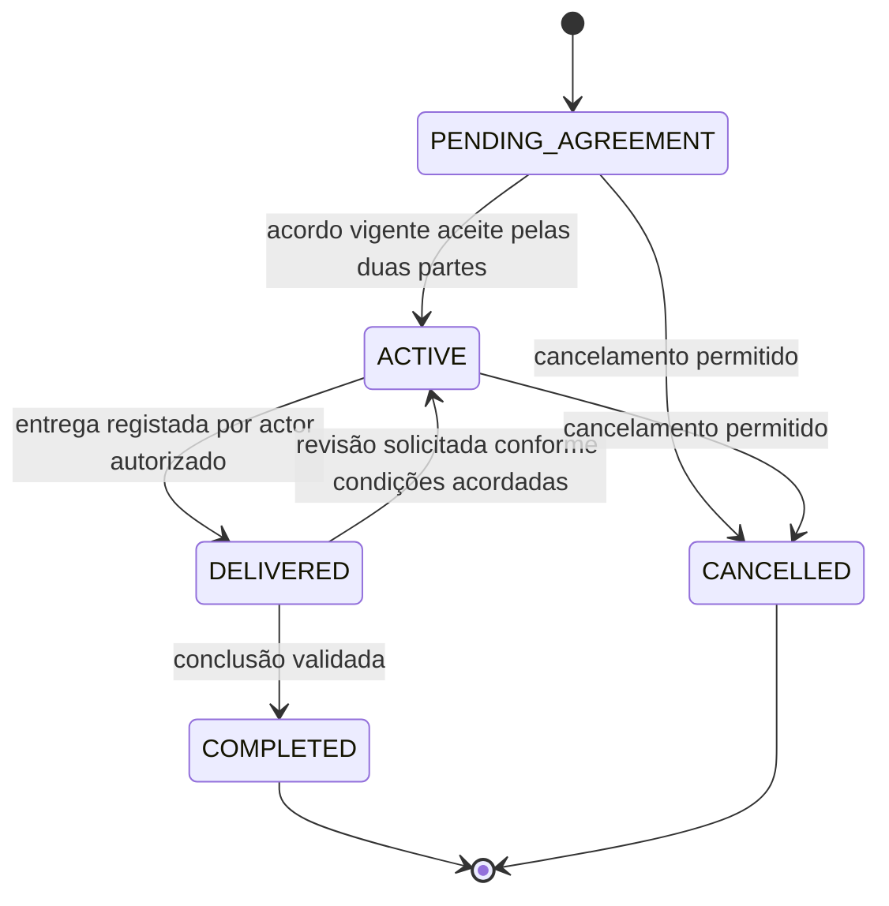
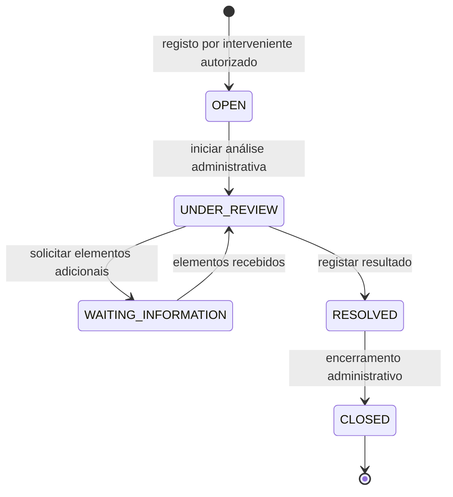
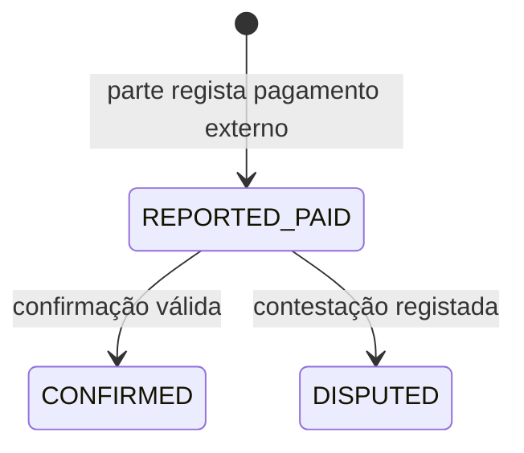
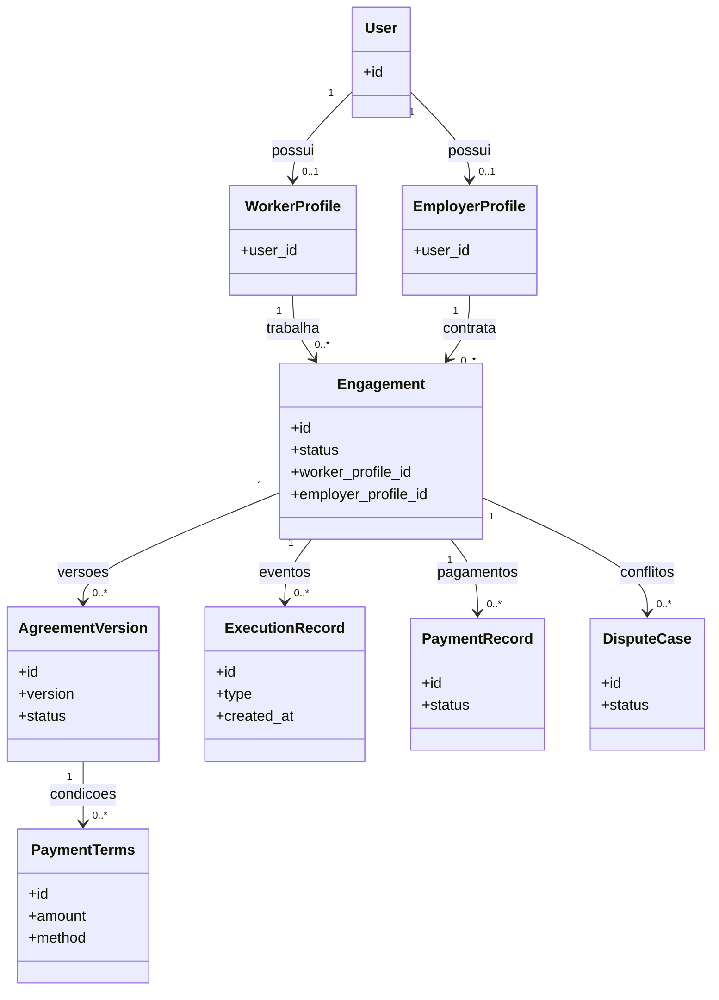

# D48 — Diagramas de estados e relações do modelo-alvo (proposta editável)

**Âmbito:** correcção conceptual da Figura 5.11 e esclarecimento das Figuras 5.2, 5.4, A.1, A.2, A.4, A.5 e A.6 da D44.  
**Estatuto:** **proposta de modelação**, não diagrama aprovado, não inserido no DOCX original nem implementação funcional. Os códigos Mermaid abaixo são fonte editável e visualizável no GitHub.

## 1. Decisão de domínio — separar os três ciclos de vida

**Alternativa A — alteração mínima:** manter `IN_DISPUTE` como estado operacional do `Engagement`. Exige persistir o estado anterior e definir todos os retornos admissíveis, guardas e conflitos com pagamentos. **Não recomendada**: cada nova categoria de conflito aumenta a complexidade da máquina de estados e pode apagar o progresso operacional.

**Alternativa B — modelo recomendado:** `Engagement.status` representa **somente o serviço**; `DisputeCase.status` representa **somente o tratamento administrativo do conflito**; `PaymentRecord.status` representa **somente o estado financeiro de um pagamento**. Indicadores `temConflitoAberto` ou `temPagamentoContestado` podem ser **derivados**, não estados que substituem o ciclo principal. A abertura de conflito não conclui, cancela, valida uma entrega ou confirma pagamento sem evento próprio e autorização.

**Decisão não aprovada:** a adopção de B requer actualização coordenada da Figura 5.11, classes, DA04/DS04, RN13/RN14, RF24/RF25, testes V04/V05/V07 e §5.2.6. O conteúdo da monografia não deve assumir que esta escolha já foi efectuada.

### Figura 5.11 — proposta: estados operacionais de Engagement



**Nota:** as duas setas de cancelamento têm guardas ainda por definir, em conformidade com as condições aceites. O ramo de revisão `DELIVERED → ACTIVE` exige formalizar a alteração do estado e manter o histórico de entregas. Não introduzir `IN_DISPUTE` como substituto destes estados sem decisão formal.

### Figura complementar — estados de DisputeCase



**Nota:** `RESOLVED` significa resultado administrativo registado, não sentença, arbitragem jurídica, validação automática de pagamento ou confirmação de entrega.

### Figura complementar — estados de PaymentRecord (pagamento externo reportado)



**Nota:** a figura representa apenas o cenário de registo externo/manual. Se RF20 for implementado, haverá um subfluxo de PSP com estados e referências verificadas. Um `PaymentRecord DISPUTED` **não é o mesmo** que `DisputeCase UNDER_REVIEW`; pode originar um processo de conflito se a política o exigir. Os estados de saída de `PaymentRecord DISPUTED` não foram especificados na D44 e não devem ser inventados.

## 2. Relações centrais e multiplicidades (correcção candidata da Figura 5.2)



### Decisão de cardinalidade ainda necessária

A D44 apresenta **Engagement PENDING_AGREEMENT criado após proposta aceite**, enquanto DA02/DS02(A) só criam `AgreementVersion v1 PROPOSED` depois disso. Portanto, a multiplicidade `1..*` da Figura 5.2 original não é garantida em todos os momentos.

**Proposta B1 (preferida):** cardinalidade `0..*` e invariante `Engagement.status in {ACTIVE, DELIVERED, COMPLETED} ⇒ existe AgreementVersion ACCEPTED vigente`. Esta escolha preserva DS01 e DA02 sem criação implícita de v1.

**Alternativa B2:** manter `1..*`, mas criar `v1 PROPOSED` na mesma transacção que cria Engagement. Isso exige mudar DS01/DA02 e o contrato de aplicação.

**Nenhuma escolha substitui a validação com o supervisor;** não alterar o DOCX sem confirmar qual das duas corresponde ao modelo pretendido.

## 3. Aceitação bilateral da versão

A Figura 5.4 e A.4(A) mostram a submissão de condições pelo proponente e um aceite pela contraparte. **O acto de submeter condições pode significar anuência, mas isso precisa estar explicitado**.

**Proposta mais auditável:** representar dois registos de aceite ligados ao mesmo `AgreementVersion`, um de cada parte, ambos com `actor_id`, `version_id`, `accepted_at` e `conditions_hash` (quando aplicável). A versão só passa para `ACCEPTED` quando **ambas as aceitações válidas** existem e referem o conteúdo vigente. Evitar aceitar a versão automaticamente por simples visualização.

```mermaid
sequenceDiagram
    autonumber
    participant P as Parte proponente
    participant API as API / AgreementService
    participant C as Contraparte
    participant DB as Persistência
    P->>API: propor condições
    API->>DB: guardar v1 PROPOSED
    P->>API: aceitar v1 (conteúdo vigente)
    API->>DB: guardar aceite do proponente
    C->>API: aceitar v1 (mesma versão)
    API->>DB: guardar aceite da contraparte
    API->>API: validar partes distintas e dois aceites
    API->>DB: v1 ACCEPTED; Engagement ACTIVE
```

**Opção alternativa:** tratar a submissão assinada da proposta como aceite do proponente, com prova inequívoca do conteúdo e identidade. Só escolher se houver decisão explícita e invariantes verificáveis.

## 4. Fontes das figuras de conflito: corrigir remissões

A Figura A.2 (DA04) e os painéis A.6(B–C) (DS04) incluem RF26 e/ou RF27 nas fontes, mas esses requisitos correspondem a **gestão de utilizadores** e **moderação de oportunidades**, não aos procedimentos de conflito representados.

- A.2: relacionar com **RF17, RF24, RF25; RN13, RN14, RN16; RNF04**.
- A.6(B): relacionar com **RF24, RF25; RN13, RN14, RN16; RNF02, RNF04** se o controlo administrativo de autorização estiver efectivamente previsto.
- A.6(C): relacionar com **RF25; RN13, RN14, RN16; RNF04**.

A existência de permissão administrativa num diagrama não justifica incluir RF26 por associação vaga. Rever todas as fontes e legendas com o manual USTM aplicável; não transferir estas notas para o corpo da dissertação.

## 5. Guardas mínimas e ensaios obrigatórios

| ID | Invariante / guarda | Cenário de verificação | Esperado |
|---|---|---|---|
| G01 | Um utilizador pode possuir ambos os perfis, mas nunca ser ambas as partes da mesma contratação | Mesma conta em `worker_profile.user_id` e `employer_profile.user_id` | Rejeitar a autocontratação, não rejeitar os dois perfis |
| G02 | A proposta aceite gera `PENDING_AGREEMENT`, não `ACTIVE` | Aceitar proposta de outra conta | Criar contratação pendente |
| G03 | Não activar sem duas aceitações válidas da versão vigente | Só um aceite; aceitar versão anterior; aceitar como estranho | Manter PENDING_AGREEMENT; rejeitar operação inválida |
| G04 | Não alterar acordo aceite no lugar | Propor e rejeitar `vN+1` | `vN` permanece aceite/vigente e histórico preservado |
| G05 | Registar a entrega antes de concluir | Invocar conclusão ainda em `ACTIVE` | Rejeitar; não registar COMPLETED |
| G06 | Conclusão requer autor autorizado e condição de entrega | Empregador confirma entrega válida | `DELIVERED → COMPLETED` |
| G07 | Abrir conflito não substitui status do serviço | Abrir conflito quando `DELIVERED` | `DisputeCase OPEN`, `Engagement DELIVERED` mantido; indicador derivado opcional |
| G08 | Resolver conflito não autoriza concluir serviço sem aceitação | Administrador encerra disputa | DisputeCase CLOSED; Engagement operacional inalterado salvo evento independente válido |
| G09 | Registo de pagamento não confirma liquidação | Pagador reporta pagamento externo | `PaymentRecord REPORTED_PAID` |
| G10 | Confirmação deve identificar actor autorizado ou resposta autenticada do PSP | Pagador tenta confirmar unilateralmente | Recusar confirmação sem evidência exigida pela política |
| G11 | Contestação de pagamento não implica mudar a contratação | Contraparte contesta pagamento | `PaymentRecord DISPUTED`; `Engagement.status` permanece válido |
| G12 | Todos os eventos materiais registam actor, data e referência ao recurso | Propor, aceitar, entregar, concluir, reportar | Histórico persistente e auditável |
| G13 | Acesso depende da relação com o recurso | Conta não interveniente tenta alterar condições ou encerrar disputa | Negar, sem alterar dados |
| G14 | Verificação administrativa não equivale a arbitragem | Administrador regista um resultado de caso | Apenas resultado administrativo, sem atribuir decisão jurídica vinculativa |
| G15 | Pagamentos PSP são opcionais | Executar sem PSP configurado | RF20 assinalado como não implementado; nunca simular sucesso financeiro |
| G16 | Integridade de aceitação versionada | Contraparte aceitou v1, proponente altera conteúdo | Exigir aceites sobre versão e conteúdo actuais |

**Estado dos testes:** **não executados**. Estes itens são especificações para ensaios V01–V08 e RNF02/RNF04, não evidência de que os guards estejam implementados.

## 6. Pontos positivos dos diagramas originais que devem permanecer

- Proposta aceite inicia contratação em `PENDING_AGREEMENT`.
- `ACTIVE` exige acordo aceite e partes distintas.
- Entrega e conclusão do serviço são estados diferentes.
- Pagamento tem ciclo de vida separado, não é automaticamente confirmado pela conclusão.
- `AgreementVersion` rejeitada não apaga a versão aceite anterior.
- Processo de conflito documenta abertura, revisão, informação e encerramento sem presumir poder arbitral.

## 7. Critério de fecho D48

1. Confirmar com autora/supervisor se se adopta o **modelo recomendado B** (três ciclos independentes) e B1 (AgreementVersion 0..*), ou as alternativas A/B2.
2. Confirmar semântica de aceitação inicial: duas acções explícitas ou submissão do proponente como aceite registado.
3. Rever modelos e legendas como conjunto (5.2, 5.4, 5.11, A.2, A.4, A.6); **não corrigir uma figura isolada**.
4. Executar G01–G16 no software após implementação; recolher logs/dados reais de ensaio e actualizar a matriz de validação.
5. Inserir os gráficos derivados apenas no DOCX canónico com preservação dos 14 comentários, campos, estilos e referências cruzadas. **Não declarar a monografia corrigida enquanto o Word não for realmente actualizado.**

**Artefactos vectoriais de apoio:** existem PNG e SVG produzidos localmente para as três máquinas de estados; o código Mermaid acima fornece fonte textual editável para reconstrução em qualquer editor compatível. As imagens **não foram integradas na D44**.
